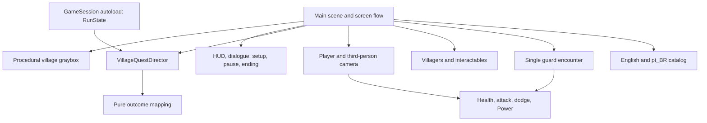

# Game architecture: village v0 and later campaign

Status: initial playable pass. `PLAN.md` tracks remaining delivery and validation; the local `GAME_DIRECTION.md` remains the narrative direction draft. The first village implementation is deliberately compact and can be split further after the playable loop is validated.

## Decisions

| Area | v0 decision | Later growth path |
| --- | --- | --- |
| Engine | Pin Godot 4.7.2 stable, standard build, with typed GDScript. Do not add a JavaScript runtime to gameplay. | Upgrade deliberately after exported-build and test checks; add native extensions only for a measured need. |
| First platform | macOS desktop export for the current development and playtest host; keyboard only. | Add Windows and Linux presets after the slice works. Keep input actions independent of physical keys. |
| World | One compact `Village` scene with placeholder geometry and authored encounter positions. | Load additional region scenes through the same screen flow; do not create an open-world streaming system for v0. |
| State | One in-memory `RunState` owned by a small `GameSession` autoload. | Add versioned disk serialization when saves become a campaign requirement. |
| Narrative | One explicit village quest director and typed outcome rules. Dialogue content is separate from rules. | Add quest modules per region; generalize shared patterns only after a second quest proves them. |
| Localization | Stable text keys in Godot-imported CSV with `en` and `pt_BR` columns (the project's player-facing locale is `pt-BR`). | Keep keys stable if content later moves to PO/gettext or a narrative tool. |
| Dependencies | Godot built-ins and repository-owned content only. | Evaluate licenses, cost, and maintenance before adopting plugins or services. |

Godot's [scene organization guidance](https://docs.godotengine.org/en/stable/tutorials/best_practices/scene_organization.html) supports self-contained reusable scenes, and its [autoload guidance](https://docs.godotengine.org/en/stable/tutorials/scripting/singletons_autoload.html) supports state shared across scene changes. The chosen version is an [official stable release](https://godotengine.org/download/archive/).

## Runtime boundaries



- `Main` currently builds the title setup, procedural village, dialogue, HUD, pause, and ending UI in one scene. It translates interactions and UI choices into calls on the quest director. Split those elements into reusable scenes after the loop is verified.
- `GameSession` owns the current `RunState` and selected locale. Fresh runs reset session data; retry uses the quest director and reloads the village scene. It does not inspect village geometry.
- `VillageQuestDirector` validates and advances quest beats, including task prerequisites, awakening, decision, and retry. `VillageQuestRules` maps custody and testimony to the local outcome.
- Actors own movement, health, attacks, and the Power interaction. Tovin follows during the quest but has no combat AI.
- The current dialogue presenter is part of `Main`; it displays localized keys and sends choice IDs to the director. UI does not directly advance beats.

Prefer direct references inside a scene and typed signals between its parts. A global event bus would make the single village harder to trace. Cross-scene state passes through `GameSession`.

## Run state and quest flow

`RunState` is a typed, non-node data object. Its v0 fields are: protagonist selection (male/female), origin ID, motivation ID, quest beat, whether the Power has awakened, custody choice, testimony choice, and the small set of outcome/one-shot flags needed to prevent duplicate events. The selected language is a user setting, not a narrative choice. Health and enemy positions live in the active scene unless an encounter checkpoint needs them.

The village uses explicit beats:

`PERSONAL_TASK → RECORD_REQUEST → SEIZURE → AWAKENING → POWER_TRIAL → DECISION → CONSEQUENCE → COMPLETE`

Only the director can advance a beat. The three-minute route begins with Serah's request and includes the order and villagers' positions in one conversation before the seizure. The older rope task remains in the code but is not part of this route. A choice is recorded once; revisiting an interaction reads the recorded result. A pure `VillageQuestRules` function maps custody and testimony to a relationship response, a concrete local response, and ending dialogue IDs. It preserves witnesses' independent knowledge, so a player's silence cannot clear the witnessed awakening.

Before the seizure, `GameSession` takes an encounter checkpoint after the request is resolved. Retry restores that snapshot, reloads the village encounter, and keeps earlier character choices and completed personal-task dialogue. Fresh run creates a new `RunState`. Scene initialization reads the state and is idempotent: it must not replay rewards, repeat the awakening, or duplicate consequences merely because the scene loaded.

The scripted awakening and the later player-controlled ability are separate events. The ability remains unavailable until the awakening beat finishes; afterward it can be tried once in a safe interaction or target area without adding another combat encounter.

## Scene and content layout

```text
project.godot
game/
  main.tscn and main.gd
  session/game_session.gd
  session/run_state.gd
  actors/player.gd
  actors/guard.gd
  actors/power_marker.gd
  village/village_quest_director.gd
  village/village_quest_rules.gd
  i18n/strings.csv
docs/V0_OPENING.md
tests/run_rules.gd
```

Reusable actor scenes should not contain absolute paths to `Village` or `Main`. `Player` is a `CharacterBody3D` with camera pivot, collision, movement, dodge, basic attack, health, and a limited Power ability as small child scripts/nodes. The sole enemy archetype has its own simple behavior and shares only damage/health contracts that both actors actually need. Interaction targets expose a small typed interaction contract; the player chooses the nearest valid target and the director decides what that interaction means for the quest.

Dialogue is authored as small Godot text resources (`.tres`) with stable conversation, speaker, line-key, and option IDs. Conditions are limited to the v0 selections and current beat, using explicit typed fields or enums. Avoid a generic expression language, arbitrary script snippets in content, or a graph editor for one quest. `strings.csv` holds the English source and Brazilian Portuguese text under Godot's `pt_BR` locale code; code and resources refer only to keys. Godot supports [CSV translation import](https://docs.godotengine.org/en/stable/tutorials/i18n/localization_using_spreadsheets.html) and [runtime language selection](https://docs.godotengine.org/en/stable/tutorials/i18n/internationalizing_games.html).

## Input and camera contract

The keyboard bindings are `WASD` movement, arrow keys for camera orbit, `F` basic attack, `Space` dodge, `E` interact, `Q` Power ability after unlocking, `Esc` pause/back, and `Tab`/`Enter` for menus. Set gameplay controls as Godot input actions so later remapping and controller support remain possible. The camera follows behind the player, avoids wall clipping, and keeps combat targets and nearby interaction prompts readable. Exact sensitivity, distance, and attack timing are prototype tuning values.

## Validation and expansion seams

- Use headless tests for beat prerequisites, custody/testimony outcome mapping, fresh-run reset, checkpoint retry, and localization key completeness. Write a failing test before implementing each behavior. Keep scene-level tests for combat collision and camera behavior focused; verify the exported build manually on the selected platform.
- Test the six-beat route and both custody outcomes in both languages. Sample origin, motivation, and protagonist variations without multiplying redundant full playthroughs.
- The later campaign can add `regions/<region_id>/` scenes and their own quest directors. Stable IDs for regions, quests, choices, and dialogue let a future save format refer to content without storing scene node paths.
- When disk saves are needed, serialize an explicit, versioned snapshot of run data rather than the live scene tree. Add migration rules when a shipped save schema changes. V0 needs only session state and encounter retry.
- Add factions, companions, ability progression, and world travel only when their gameplay exists. Those systems can consume the same typed run facts and signals; none requires a v0-wide faction engine, party manager, streaming world, or service backend.

## Decisions still owned by opening design

The opening decisions used by the current build are recorded in `docs/V0_OPENING.md`. The first macOS build is for local playtesting; any public distribution still needs the fan-work review noted in `GAME_DIRECTION.md`.
